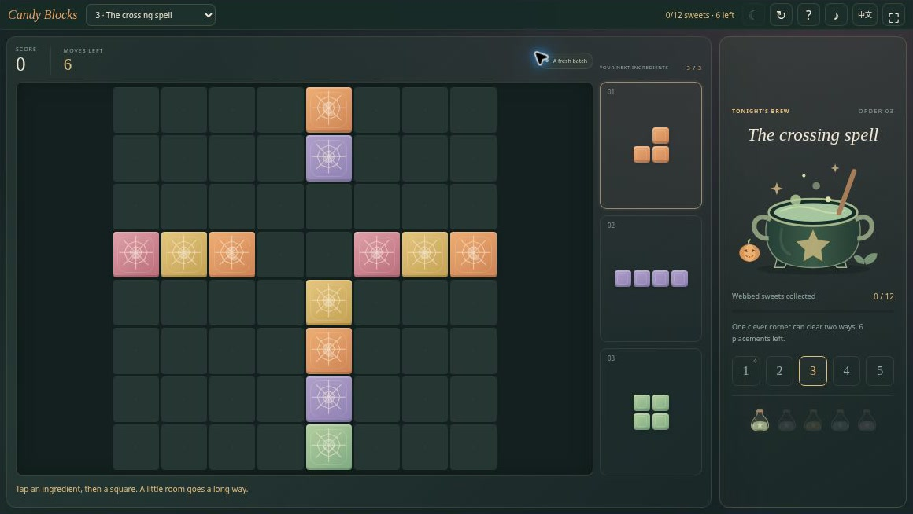
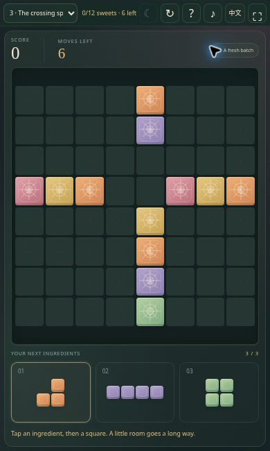

# Witch’s Candy Blocks — Halloween Block Puzzle Game

**Make a little room. Brew a little magic.** Witch’s Candy Blocks is a free Halloween block puzzle from Midnight Candy Club, created for [BlockBlasty](https://blockblasty.top/). Fit candy-shaped pieces into an 8×8 board, complete rows and columns, and send every clear into the witch’s cauldron.

**[GitHub Pages deployment target](https://ashintop.github.io/halloween-block-blast/)** · [Embedding guide](EMBEDDING.md)

**Deployment status:** GitHub Pages is not live yet. The `ashintop.github.io` links in this document are intended deployment addresses. Use the local-run instructions until the hosted game has been published and verified.

[Video player and transcript (deployment target)](https://ashintop.github.io/halloween-block-blast/intro.html) · [Captioned MP4 file](docs/media/intro.mp4). The 24-second silent introduction uses actual game screenshots; it is not a live gameplay recording.



Like this little candy workshop? **[Star the repository](https://github.com/AshinTop/halloween-block-blast)** to save it for another round and follow future updates.

## Familiar blocks, a Halloween twist

Each batch contains three pieces. Place them anywhere they fit, without overlap, and fill an entire row or column to clear it. You receive a new batch only after using all three pieces. A careful placement can complete both a row and a column; their shared cell clears only once.

The Halloween theme extends into two play modes. **Classic** is an open-ended score challenge: every twelve cleared lines fills another bottle of midnight magic. **Potion Orders** offers five fixed, bite-size puzzles where the goal is to remove the original sweets marked by cobwebs within a placement budget.

Every run also has one **Moon Rewind**. It restores the previous placement, including the board, tray, score, goals, and random sequence, so the second attempt is a real alternative to the same position.

## Features

- Complete 8×8 block placement, occupied-cell and boundary checks, simultaneous row/column clears, and legal-move game-over detection.
- A three-piece tray with all-used refill timing and no forced piece rotation.
- Placement and line-clear previews, real drag-and-drop, and a select-then-tap alternative.
- Endless Classic scoring plus five authored Potion Orders with tested completion paths.
- One exact Moon Rewind per run, a restart action, clear result screens, and real result sharing.
- Original candy, cobweb, bottle, and cauldron vector art; optional synthesized sound.
- English and Simplified Chinese, keyboard controls, responsive iframe layouts, and reduced-motion support.
- Local best score, Classic progress, completed orders, language, and sound preference.
- Plain static HTML/CSS/JavaScript modules. No account, framework, backend, CDN, or dependency installation is needed to play.

## How to play

1. Look at all three shapes before placing the first one.
2. Drag a shape onto the board, or select it and tap the cell where its top-left corner should land.
3. Fill all eight cells of a row or column to clear it. **Colors do not need to match.**
4. Use every shape in the tray to receive the next batch.
5. Leave space for larger shapes. A Classic run ends only when none of the remaining tray pieces has a legal placement.
6. In Potion Orders, clear every initially webbed sweet before using the placement budget. Newly placed candy does not become another required target.

There is no falling-block timer. Shapes do not rotate. Moon Rewind can undo one placement in a run, including a position that just ran out of space, provided the order has not already been completed.

## Controls

| Action | Touch / mouse | Keyboard |
|---|---|---|
| Select a tray piece | Tap it | 1 / 2 / 3 |
| Place a piece | Drag to the board, or tap its top-left landing cell | Arrows position the cursor; Enter places |
| Undo the previous placement once | **Moon Rewind** | Z |
| Restart or change mode | In-game buttons / compact menu | Tab to a control |
| Help, sound, language | Toolbar buttons | Tab to a control |

Keyboard input requires focus inside the game iframe. Tap-to-place remains available when dragging is inconvenient on a small screen.

## Two ways to visit the workshop

| Mode | Goal | Replay behavior |
|---|---|---|
| Classic | Keep placing pieces and improve your score; every 12 lines brews a bottle | Browser storage restores an unfinished Classic run when available |
| Potion Orders | Clear the original webbed sweets within the placement limit | Five fixed boards and piece sequences; share or retry a specific order |

The five orders teach a single-row clear, paired rows, a crossing clear, planning for all three pieces, and double-row finishes. They are short spatial puzzles, not a large randomly generated campaign. All five have complete tested solution witnesses in [engine.js](engine.js).

A link such as [`#order=3`](https://ashintop.github.io/halloween-block-blast/#order=3) opens the third order. Result sharing copies the real score or order outcome and a link. It does not create a cloud replay or transmit a saved board.

## Compact-player walkthrough



Choose one of the three pieces, then tap its top-left landing cell. The placement preview helps you check a shape before committing it. Full rows and columns clear regardless of candy color.

*Actual interface captured in a browser iframe sized for the host player. This is a compact-window illustration, not a physical-phone test.*

## Embed the Halloween block puzzle

```html
<iframe
  src="https://ashintop.github.io/halloween-block-blast/?embed=1"
  title="Witch’s Candy Blocks — Halloween block puzzle"
  style="display:block;width:100%;height:654px;border:0"
  allow="fullscreen"
  allowfullscreen
></iframe>
```

The game detects an iframe automatically. `?embed=1` also enables the compact layout in a direct visit; `?embed=0` shows the full-page presentation. The desktop host provides a **654 px**-high game area. The compact layout also supports portrait phone and short landscape windows, placing the tray beside or below the board as space allows.

Browser acceptance exercised **1160×654**, **390×650**, and **844×340**-class windows, including an order completion and Moon Rewind. This is browser-based CSS-size testing, not a claim of testing physical iOS or Android hardware. Help and result dialogs can scroll internally. See [EMBEDDING.md](EMBEDDING.md) for exact sizing, storage, clipboard, and fullscreen behavior.

## Run locally and verify the rules

```bash
python3 -m http.server 4173
```

Open `http://localhost:4173`. Serve the files over HTTP(S); ES modules need a server rather than a plain `file://` opening.

```bash
npm test
```

The built-in Node tests cover illegal placements, simultaneous crossing clears, tray refill timing, game-over rules, deterministic random generation, all five order solutions, terminal-state protection, and validation of saved Classic data. There is no dependency installation or build step.

## FAQ

### Is this a match-three game?

No ingredient colors need to match. You clear full eight-cell rows and columns by fitting shapes into the board. If you prefer swapping neighboring ingredients, try [Witch’s Potion Match](https://github.com/AshinTop/halloween-potion-match).

### Why won’t the tray refill yet?

Every batch contains three pieces. All three must be placed before the next batch appears. Planning around the least convenient shape can be more useful than placing the easiest one first.

### What does Moon Rewind restore?

It restores the entire previous placement state, including scoring, cleared lines, tray pieces, webbed targets, and the random stream. There is one rewind per run; it is not unlimited undo.

### Does it save my game or collect information?

Classic progress and local records are stored in the browser when permitted. The game code has no login, analytics, advertising SDK, remote API, or external asset requests. Sharing copies text and a link. If storage or clipboard access is blocked, gameplay continues and sharing falls back to manually copyable text. Your hosting provider may have its own standard request logs.

### Can I move progress to another device?

There is no account or synchronization service. Progress belongs to the browser and origin; embedded and direct visits may use different storage partitions. Clearing site data removes local records.

## More Halloween games

| Game | Try a different kind of puzzle |
|---|---|
| [Witch’s Potion Match](https://github.com/AshinTop/halloween-potion-match) | Swap ingredients, trigger cascades, and light recipe candles. |
| [Pumpkin 2048](https://github.com/AshinTop/halloween-2048) | Merge numbered pumpkins and solve limited-move lantern trials. |
| [Trick-or-Treat TriPeaks](https://github.com/AshinTop/halloween-tripeaks) | Clear a layered Halloween card tableau by rank. |
| [Haunted Hearts](https://github.com/AshinTop/halloween-love-game) | Help two ghosts share doors, pathways, and a lantern. |

**简体中文：**《女巫糖果工坊》包含经典 8×8 方块清行、五份固定魔药订单和每局一次月光回溯。可拖动或先选后放，支持键盘和中英文切换；颜色无需匹配，进度只保存在本地浏览器。

## Creation credits

Designed, implemented, and reviewed through human-directed AI collaboration. The gameplay implementation, interface, and original SVG artwork were created for this project; optional sound is synthesized in the browser. Screenshots show the actual interface, and the short video is a captioned visual introduction assembled from those captures.
